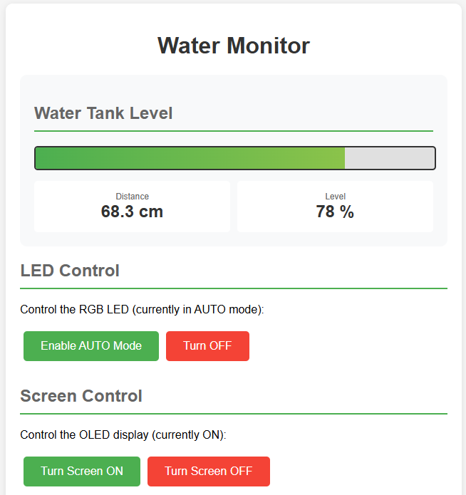
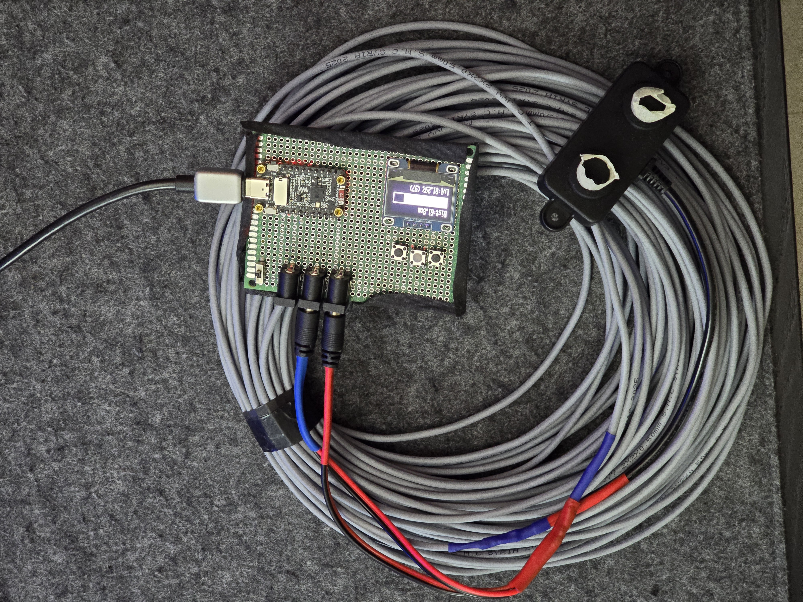
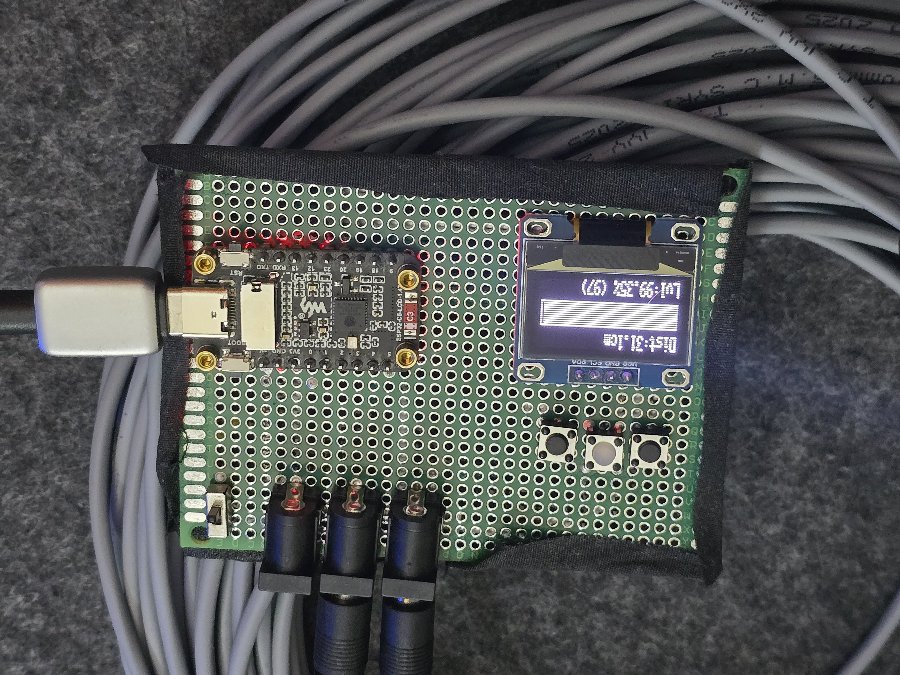
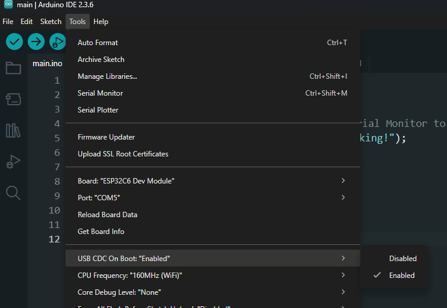

# ESP32-C3 Water Level Monitoring System

Ultrasonic tank-level monitor with 
**A02YYUW sensor**, **0.42" 72x40 SSD1306 OLED**, 
and an onboard status **LED**, 
featuring WiFi setup and live web dashboard.

##  Features
- **A02YYUW ultrasonic distance sensor** (UART)
- **SSD1306 OLED display** (I²C, U8g2) for live readings
- **Onboard LED** status indicator (auto red/yellow/green by level)
- **Several saved Wi-Fi networks** (up to 5) in priority order, see [Wi-Fi networks](#wi-fi-networks)
- **WiFi setup portal** (`ESP32-Config` access point) when no saved network works
- Tank setup: height, sensor gap and up to 4 parallel tanks → litres and percent
- 24 h / 7 day level history graph
- **Time** settings on the web page: time zone as GMT offset (+1 h summer time switch); clock set from the internet, or from your phone when offline
- Web page at `http://watertank.local`, firmware updates over Wi-Fi (OTA)
- Modular C++/ESP32 code (PlatformIO)

## API (for other devices)

Other devices on the same network (e.g. a second ESP with a big screen) can read the level.
Use the board's address: `http://watertank.local` or its IP (shown on the OLED).
Reading by IP is faster and more reliable from another ESP. Give the board a fixed IP (DHCP reservation) in your router.

**`GET /api/level`** — JSON:

```json
{"valid":true,"percent":45.2,"litres":720,"capacity":1592,"depth":77.1,"distance":122.9,"age":1,"time":1795033980}
```

| Field | Meaning |
|-------|---------|
| `valid` | `false` when the sensor isn't answering; the numbers are then `-1` |
| `percent` | Water level 0–100 % (by volume when tank sizes are set) |
| `litres`, `capacity` | Water now / when full, in litres. `-1` if no tank sizes are set |
| `depth`, `distance` | Water depth and sensor distance, in cm |
| `age` | Seconds since the last good sensor reading |
| `time` | Board's clock (unix seconds, UTC), `0` if not set |

**`GET /api/level.txt`** — plain text `percent;litres`, e.g. `45.2;720`. Easy to read without a JSON library.

Example for the display ESP (Arduino):

```cpp
#include <WiFi.h>
#include <HTTPClient.h>

void readTank() {
  HTTPClient http;
  http.begin("http://192.168.88.27/api/level.txt");   // the water tank board
  http.setTimeout(3000);
  if (http.GET() == 200) {
    float percent; int litres;
    if (sscanf(http.getString().c_str(), "%f;%d", &percent, &litres) == 2 && percent >= 0) {
      Serial.printf("Tank: %.0f %%, %d L\n", percent, litres);   // draw it on your screen here
    }
  }
  http.end();
}
// Call readTank() every few seconds from loop(). The level updates about 3 times a second.
```

## Wi-Fi networks

The web page has a **Wi-Fi Networks** list (up to 5). The order is the priority: #1 is the main network.

- At start-up the device joins the highest network in the list that is in range and accepts the password.
- If that connection drops for more than 20 seconds, it tries the next networks in the list.
- When it is on a lower network, it checks every **10 minutes** whether a higher one (e.g. the main network) is back in range, and switches to it.
- If no network works, it opens the `ESP32-Config` setup network (page at `http://192.168.4.1`) and keeps retrying the list every minute.
- On the page: **▲ / ▼** change the priority, **Connect** switches to a network now, **✕** deletes it. Saving a name that is already in the list changes its password.
- The intervals are constants at the top of the connection manager in `main/user-wifi.cpp`.
- A new board (or one reset with the BOOT button) starts with the network from `main/secrets.h` (copy `main/secrets.example.h` to make it).

##  Project Structure

esp32-distance-sensor/
├── README.md
├── main/
│ ├── platformio.ini # Build + upload settings (USB and OTA)
│ ├── main.cpp # Main application
│ ├── A02YYUW.h / A02YYUW.cpp # Ultrasonic sensor driver
│ ├── user-led.h / user-led.cpp # Onboard LED control
│ ├── user-screen.h / user-screen.cpp # OLED display module
│ ├── user-tank.h / user-tank.cpp # Tank sizes -> litres and percent
│ ├── user-history.h / user-history.cpp # 24 h / 7 day history
│ ├── user-networks.h / user-networks.cpp # Saved Wi-Fi networks list
│ ├── user-clock.h / user-clock.cpp # Clock (NTP) + time zone
│ ├── user-wifi.h / user-wifi.cpp # Wi-Fi connection, web server, OTA
│ └── secrets.example.h # Copy to secrets.h for the default Wi-Fi
└── libraries/
└── ...


##  Wiring

### A02YYUW → ESP32-C3

| Sensor Wire | ESP32-C3 Pin |
|-------------|--------------|
| Red (5V)    | 5V           |
| Black (GND) | GND          |
| White (TX)  | GPIO 4 (RX)  |
| Yellow (RX) | GPIO 7 (TX)  |

| Sensor Wire | 2 pair cable | DC Barrel Jack | ESP32-C3 Pin |
|-------------|--------------|----------------|--------------|
| Red (5V)    | orange       | Red            | 5V           |
| Black (GND) | brown        | Black          | GND          |
| White (TX)  | blue         | Black          | GPIO 4 (RX)  |
| Yellow (RX) | green        | Red            | GPIO 7 (TX)  |

### OLED (SSD1306, 0.42" 72x40) → ESP32-C3

| OLED Pin | ESP32-C3 Pin |
|----------|--------------|
| VCC      | 3.3V         |
| GND      | GND          |
| SDA      | GPIO 5       |
| SCL      | GPIO 6       |

### Onboard LED → ESP32-C3

The status LED is the board's onboard single-color LED, driven directly on **GPIO 8** — no external wiring needed.

### Buttons → ESP32-C3

| Button              | ESP32-C3 Pin | Other side | Behavior                          |
|----------------------|--------------|------------|------------------------------------|
| Screen toggle button | GPIO 3       | GND        | Short press: toggle OLED on/off    |
| WiFi reset = board's **BOOT** button | GPIO 9 (built-in) | — | Hold 3 seconds while running: forgets all saved Wi-Fi networks |

---


## ESP32-C3 Connections

| Source         | Destination         |
|----------------|---------------------|
| 5V             | A02YYUW RED         |
| GND            | A02YYUW BLACK       |
| GND            | SSD1306 GND         |
| GND            | Screen toggle button |
| 3.3V           | SSD1306 VCC         |
| GPIO 3         | Screen toggle button |
| GPIO 4         | A02YYUW White (RX)  |
| GPIO 5         | SSD1306 I2C_SDA     |
| GPIO 6         | SSD1306 I2C_SCL     |
| GPIO 7         | A02YYUW Yellow (TX) |
| GPIO 8         | Onboard LED (built-in) |
| GPIO 9         | BOOT button (built-in): Wi-Fi reset |


## Screen shot of Webserver:




 ## Photos:

 
 


## don't forget to turn on UART Serial.



## ⚙️ Other Details

- **Cable**: 2-pair, 30 meters
- **DC Inputs**:
  1. 5V power input
  2. RX/TX for UART communication
  3. 5V output to sensor
- **Buttons**:
  - **Power switch**: Turns the device on/off (inline, not GPIO-controlled)
  - **Screen toggle button** (GPIO 3): Turns OLED display on/off
  - **WiFi reset**: the board's own **BOOT** button (GPIO 9). Hold 3 seconds while running to forget all saved Wi-Fi networks
